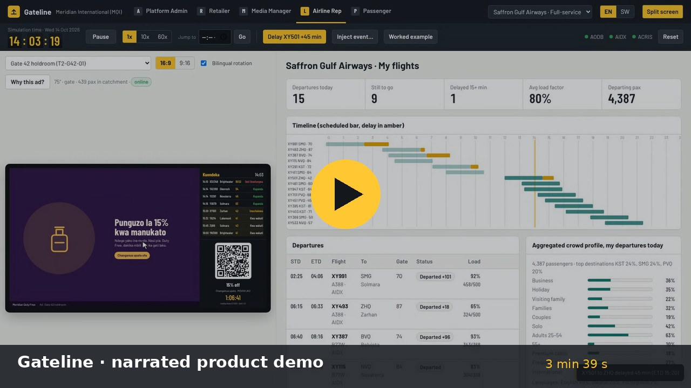
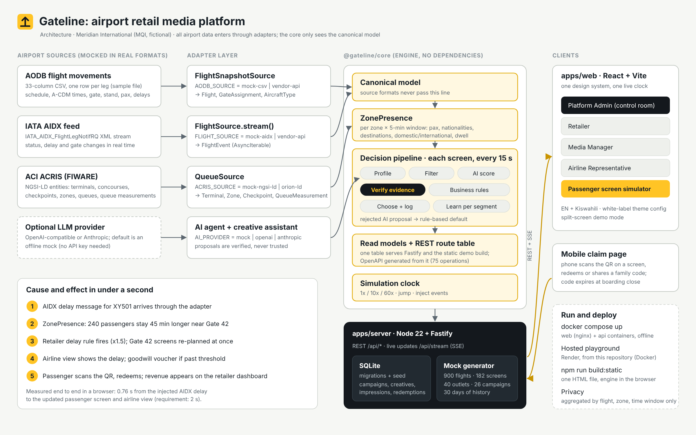
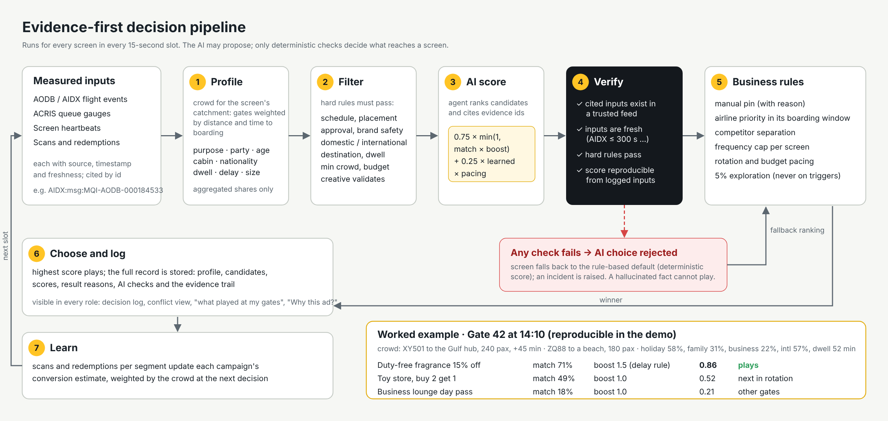

# Gateline — airport retail media platform (POC)

Gateline puts the right offer on the right airport screen for the passengers actually standing in front of it.
Live flight data (AODB, IATA AIDX) and passenger-flow data (ACI ACRIS) are turned into a **crowd profile per
screen per 5-minute window**, and every 15-second slot goes to the campaign that best matches that crowd —
with every decision traceable to recorded data points.

All data describes the fictional **Meridian International (MQI)** from the challenge samples. There are no real
airports, airlines or brands, and no per-passenger data anywhere in the system.

| | |
|---|---|
| **Hosted playground** | https://airportretailmediaplatform.onrender.com/ (full client–server build, pre-configured; phones can scan the QR codes) |
| **Demo video** | [`docs/media/Gateline-demo.mp4`](docs/media/Gateline-demo.mp4): 3 min 39 s, narrated, with captions ([chapters](#demo-video-3-min-39-s-narrated)) |
| **Local, one command** | `docker compose up` → http://localhost:8080 |
| **Without Docker** | `npm install && npm start` → http://localhost:8080 (Node 22.5+) |
| **API spec** | `docs/openapi.json` or `GET /api/openapi.json` |
| **Tests** | `npm test` (adapters against the attached samples, worked example, cause-and-effect, promo codes, failed creatives, Impression and GateAssignment entities) |

---

## 1. Demo

### Demo video (3 min 39 s, narrated)

[](docs/media/Gateline-demo.mp4)

**[Watch the demo (MP4, 1080p, 21 MB)](docs/media/Gateline-demo.mp4)** · captions: [`Gateline-demo.srt`](docs/media/Gateline-demo.srt) (also embedded in the MP4 as a subtitle track)

A real screen recording of this build on a fresh database, narrated end to end. Chapters:

| Time | What you see |
|---|---|
| 0:04 | What Gateline is, and the three airport feeds (AODB, IATA AIDX, ACI ACRIS), each behind an adapter |
| 0:28 | **Platform Admin:** live network map with screen health and passenger heat; presence per zone in 5-minute windows |
| 0:49 | **Passenger screen, Gate 42:** Saffron Gulf's upgrade plays because XY501 is in its boarding window (airline priority) |
| 1:06 | **Cause and effect in split screen:** an injected AIDX delay on XY501 updates the airline view and switches the gate screen to *Duty-free fragrance, 15% off* in under a second |
| 1:31 | **Why this ad?** Crowd profile, top 3 candidates with scores, and the AI verification checks |
| 1:54 | **Mobile claim:** countdown tied to XY501's boarding close, share-to-family code, redeem |
| 2:06 | **Retailer dashboard:** the redemption arrives in *Live redemptions* straight away |
| 2:18 | **Campaign builder:** live audience-match preview and the best 3 slots for tomorrow |
| 2:33 | **GenAI creative assistant:** a one-line brief becomes an ad page in English and Kiswahili, no API key |
| 2:44 | **Media Manager:** inventory priced from predicted footfall, 7-day forecast, conflict view |
| 2:56 | **Airline Rep:** delay goodwill pushes a co-funded meal voucher to the gate |
| 3:08 | **AI safety:** a fabricated citation is rejected, the screen falls back to the rule-based choice, an incident is raised |
| 3:19 | Kiswahili in one click, white-label theming, aggregated targeting only |

The voice-over is generated with an open-source neural text-to-speech voice. For the recording, *Max consecutive plays* (Admin → Decision engine) was raised from 2 to 40, so the Gate 42 screen holds the fragrance offer through the claim instead of rotating to the next campaign; everything else is the default configuration.

### Try it yourself in 60 seconds

Open the [hosted playground](https://airportretailmediaplatform.onrender.com/) (or run it locally). The simulation starts at 14:02 on Wed 14 Oct 2026. The step-by-step 15-minute script is in [`docs/demo-script.md`](docs/demo-script.md).

1. **Passenger → Gate 42 holdroom.** Saffron Gulf's upgrade offer is playing because XY501 is in its boarding window.
2. **Split screen** (header), then pick **Airline Rep** so the airline view sits beside the passenger screen.
3. **Press "Delay XY501 +45 min"** in the simulation bar. An IATA AIDX `FlightLegNotifRQ` goes through the AIDX adapter, and within one tick:
   - the airline view shows the delay and the FIDS strip shows *Delayed 15:20*;
   - the screen switches to *Duty-free fragrance, 15% off*: the retailer's trigger rule (Gulf flight delayed 30+ min at gates 40–45 → ×1.5) fires;
   - footfall in the zone rises, because XY501's 240 passengers now stay airside 45 minutes longer.
4. **Press "Why this ad?"** for the crowd profile, the top 3 candidates with scores, the winning rule and the evidence trail.
5. **Scan the QR with a phone** (or click it). Share a family code, redeem, and the redemption lands on **Retailer → Meridian Duty Free** within a second.

The gate screen rotates campaigns as it would in production (at most 2 consecutive plays by default), so if the code you scan belongs to another advertiser, its redemption appears on that retailer's dashboard. To hold one offer on screen while presenting, raise *Max consecutive plays* in **Admin → Decision engine**.

### The worked example from the brief

The **"Worked example" button** reproduces the challenge table exactly: Gate 42 at 14:10, XY501 to the Gulf hub (240 pax, +45 min) plus ZQ88 to a beach destination (180 pax). The resulting crowd is holiday 58%, family 31%, business 22%, international 57%, with a median dwell of 52 min.

| Candidate | Audience match | Boost | Final | Result |
|---|---|---|---|---|
| Duty-free fragrance, 15% off | 71% | 1.5 (delay rule) | **0.86** | Plays |
| Toy store, buy 2 get 1 | 49% | 1.0 | 0.52 | Next in rotation |
| Business lounge day pass | 18% | 1.0 | 0.21 | Below its 25% match floor here; served at better-fit gates |

This is asserted in `packages/core/test/core.test.js`. DXB is shown as **ZHQ (Zarhan)**, the fictional Gulf hub from the samples, because the product carries no real airport codes.

## 2. Roles and screens

There is no login. Use the role switcher in the header. The Retailer and Airline roles also have a company switcher (Meridian Duty Free / Driftwood Coffee / Kite & Kin Toys; Skylark Air (low-cost) / Halcyon Airways / Saffron Gulf Airways (full-service)).

| Role | Pages | Highlights |
|---|---|---|
| **Platform Admin** (dark control-room theme) | Overview · Decision engine · Master data · Incidents & feeds | Passenger presence per zone for the current 5-minute window (count, international share, nationalities, destinations, dwell). Live SVG network map of T1/T2 with every screen coloured online/degraded/offline and a passenger heat overlay. KPI strip (screens online %, plays, impressions, revenue in configurable currency, active campaigns, latency). Auto-raised incidents (screen offline > 5 min, feed lag, failed creative, AI rejection) with severity, owner and status. Full create/edit for terminals, vendors, outlets, airlines, zones, gates and screens; a new terminal is onboarded with its zones and appears on the map. Read-only views of gate assignments and aircraft types. Rule-engine settings and a searchable decision log with evidence drawer. Feed health, raw message stream, and a box to paste any AIDX XML through the adapter. API p95, playlist build time, 7-day uptime. |
| **Retailer** | Dashboard · Campaigns & history · Creatives & promo codes | Live impressions, scans, redemptions, conversion and revenue for the selected outlet (or all outlets). Passenger flow near the store for the next 2 h ("Next 60 min: 2,692 pax, 67% international, top: ZHQ, LMW, SMG"). Campaign builder (placement by zones, screens or gates; destination, domestic/international, dwell, crowd and delay rules; delay, gate-change, boarding and festival triggers) with live audience-match preview ("Matches 64% of the crowd at … expected 3,100 impressions and 95 redemptions"), mock-screen preview, trigger rules, schedule, budget and "best 3 slots tomorrow". Performance by segment ("Families redeemed 3.2x their share") with one-click weight suggestions. Impression log per screen and hour. A/B creatives, budget pacing, out-of-stock toggle (pauses the promo network-wide). GenAI creative assistant in EN + Kiswahili. Image upload for ready-made ad pages. A creative that fails on screens is flagged in the library with a one-click re-upload. Time-boxed codes, history with ROI and "run again". |
| **Media Manager** | Inventory & yield (with packages) · Approvals · Advertisers & reports · Matching | Screen × hour calendar (available / partly booked / premium / sold) with a suggested price per cell driven by predicted presence. 7-day occupancy and revenue forecast, plus a price book. Approval queue for campaigns and stand-alone creatives, with automatic creative checks (template, both languages, contrast, asset loads) and a brand-safety checklist. Top advertisers, under-delivery flags, one-click printable/shareable report. Segment × hour heatmap per zone, an A-vs-B conflict explainer, manual pin/override with a logged reason, and a package builder. |
| **Airline Rep** | My flights · Gate messaging · Delay goodwill · Partners | Departures list and day timeline (delays in amber), aggregated crowd profile of their passengers. Sponsored content restricted to their own boarding window. "What played at my gates and why". Delay goodwill automation: past a threshold, a meal voucher co-funded with an F&B partner is auto-pushed to that gate with airline priority. Co-marketing marketplace ranked by fit, accepted in one click. Performance. |
| **Passenger** | Screen simulator | Any of the 182 screens in 16:9 or 9:16. FIDS strip of nearby departures, bilingual rotation, QR with a live countdown that expires when the linked flight closes boarding, and the "Why this ad?" overlay with the full crowd profile (crowd now and in 30 minutes, purpose, party, age bands, gender, cabin tier, nationalities, languages, destinations, dwell, delay). |

The **simulation bar** is visible to all roles: play/pause, 1x/10x/60x, jump to time, "inject event" (delay, gate change, screen offline, feed lag, failed creative, AI hallucination), worked example, and reset.

## 3. Architecture



*(Vector version: [`docs/architecture.svg`](docs/architecture.svg).)*

More detail, including the decision pipeline diagram and the data model, is in [`docs/architecture.md`](docs/architecture.md).

**Stack and why.**
- **Node 22 + Fastify** for the backend. Both are widely used and actively maintained, Fastify is fast and has first-class schemas, and Node 22 ships `node:sqlite` so there is no native build step.
- **SQLite** (embedded, with migrations and a seed script) for storage. No paid or cloud services are needed.
- **React 18 + Vite** for the frontend. This is the most common modern web stack.
- **Server-Sent Events** for live updates. They are one-way, proxy-friendly, and auto-reconnect.

The core is plain ES modules with no dependencies, so **the identical engine, adapters and route table run in Node and in the browser**. That is also how the static demo build (`npm run build:static`) runs without a server.

**Separation.** The frontend talks only to the REST API and the SSE stream. Business logic never sees CSV columns, XML or NGSI-LD: adapters translate into the canonical model (`packages/core/src/model.js`).

## 4. Data and adapters

| Source | Mock format (fixtures in `data/`) | Adapter (`packages/core/src/adapters/`) | Canonical |
|---|---|---|---|
| AODB flight movements | 33-column CSV, identical to the attached sample. The generator keeps the 320 sample legs and adds ~580 more to reach 900. | `aodb.js` — `MockAodbSource`, `VendorApiAodbSource` | `Flight` |
| IATA AIDX | `IATA_AIDX_FlightLegNotifRQ` XML. The day is replayed as messages on the sim clock; injected events use the same XML path. The attached XH960 sample parses unchanged. | `aidx.js` — `MockAidxFeed`, `VendorAidxFeed` | `FlightEvent` |
| ACI ACRIS (FIWARE) | NGSI-LD normalized entities (`TerminalFacility`, `ConcourseFacility`, `CheckpointFacility`, `QueueMeasurement`). Official examples are in `data/samples/acris/`. | `acris.js` — `MockAcrisFeed`, `OrionLdAcrisFeed` | `Terminal`, `Zone`, `Checkpoint`, `QueueMeasurement` |
| Platform-owned | SQLite tables (`apps/server/migrations/`) | — | `Terminal`, `Screen`, `Advertiser`, `Outlet`, `Campaign`, `Creative`, `PromoCode`, `Impression`, `Redemption`, `Incident` |
| Derived | — | — | `GateAssignment` (planned vs actual gate, occupancy window; `GET /api/gate-assignments`), `AircraftType` (seat configuration; `GET /api/aircraft-types`) |

Each source is switched with **one config value**: `AODB_SOURCE=mock-csv|vendor-api`, `FLIGHT_SOURCE=mock-aidx|vendor-api`, `ACRIS_SOURCE=mock-ngsi-ld|orion-ld`. Going live means writing one adapter class and nothing else; the step-by-step is in [`docs/adapters.md`](docs/adapters.md).

**Mock scale** (seeded and deterministic): 900 flights, 182 screens, 40 outlets, 13 fictional airlines, 26 campaigns with creatives in English and Kiswahili, 30 days of daily history, partner offers and packages. `npm run seed` regenerates the data, and writes `data/generated/MQI_aodb_flights_2026-10-14_GENERATED.csv` and the ACRIS entity set.

**Crowd profiles** are aggregated shares per flight: trip purpose, party type, age band, gender, cabin/spend tier, frequent-flyer share, top nationalities and languages, dwell, delay and crowd size. They follow plausibility rules: weekday peaks skew business 25–44, while Friday evening and holiday routes skew families and couples. The mid-term school break and the festival in the event calendar raise families and VFR. Profiles are rolled up per screen, weighted by gate proximity and time to boarding.

## 5. AI decision pipeline (evidence-first)




1. **Profile.** The crowd for the screen's catchment is computed from flights at nearby gates (pax × airside curve) and ACRIS queue data.
2. **Filter.** Each campaign is checked against hard rules: schedule and daypart, placement, approval, stock, budget, domestic/international, region and destination, dwell, crowd size, brand safety (adult products are kept away from family-heavy crowds), own boarding window for airlines, and goodwill binding.
3. **Score.** `final = wMatch · min(1, match × trigger boost) + wPerf · learned conversion`, × budget pacing. `match` is the weighted mean of per-segment saturation (`seg-model 2.1`).
4. **AI proposes, rules verify.** The agent (offline mock by default; LLM pluggable) ranks the candidates and *cites evidence ids*. The proposal is executed only if all four checks pass:
   - every cited input exists in a trusted feed;
   - every cited input is fresh (AIDX ≤ 300 s, ACRIS ≤ 900 s, …);
   - the chosen campaign passes every hard rule;
   - the claimed score is reproducible from the logged inputs (±0.01).

   Otherwise the screen falls back to the rule-based default. Use *Inject event → AI fault* to watch a fabricated "XY999 delayed 95 min" get rejected, or *Feed lag* to watch stale data be refused.
5. **Business rules.** In order: manual pin → airline priority in its boarding window → competitor separation → frequency cap → max consecutive plays → exploration (5%, never on triggered slots).
6. **Choose and log.** Every decision stores the profile, candidates, scores, result reasons, AI checks and evidence trail. It is visible in every role.
7. **Learn.** Scans and redemptions per segment update each campaign's conversion estimate and drive the segment lift reports.

## 6. Configuration

| Variable | Default | Meaning |
|---|---|---|
| `PORT` | 8080 | API port (also serves the built web app). |
| `LAN_IP` / `PUBLIC_BASE_URL` | — | Base URL encoded in QR codes, so a phone on the same Wi-Fi (or the public URL) opens `/claim/<code>`. |
| `CURRENCY`, `CURRENCY_SYMBOL` | USD, $ | Revenue currency. Also editable in Admin → Decision engine. |
| `AODB_SOURCE`, `FLIGHT_SOURCE`, `ACRIS_SOURCE` | mocks | Adapter selection. |
| `AODB_VENDOR_URL`, `AIDX_VENDOR_URL`, `ACRIS_BROKER_URL` | — | Live endpoints for the stub adapters. |
| `AI_PROVIDER`, `LLM_API_KEY`, `LLM_MODEL`, `LLM_BASE_URL` | mock | Optional real LLM for creative copy and "re-rank this slot": `openai` (any OpenAI-compatible endpoint, including a local Ollama or vLLM) or `anthropic`. The demo needs no key. |
| `DB_PATH` | `data/gateline.db` | SQLite file. |
| `SIM_START` | 2026-10-14T14:02Z | Simulation start time. |

**White-label.** `apps/web/src/theme.config.js` is the single place for the product name, operator name, airport display name, logo (inline SVG or image URL), colours, second language and currency. At boot it is pushed into CSS variables, the favicon and the page title, so changing it re-brands the header, buttons, map heat, passenger screens, claim page and reports.

**Languages.** Every UI label, status and engine-generated sentence (decision rules, filter reasons, alerts, feed events) is available in the second language; switch with EN / SW in the header. Strings live in `apps/web/src/i18n.js` (a dictionary plus patterns that keep data values such as flight numbers intact). Ad creatives and the passenger claim page carry their own per-language copy. Advertiser-entered data (campaign and screen names) is shown as entered. To add a language, add a dictionary there and set `THEME.secondLanguage`.

## 7. Deploying a public playground

The hosted playground runs on Render from this repository (`render.yaml`, Docker). Every push to the default branch redeploys it, and the service seeds itself on boot. Render provides `RENDER_EXTERNAL_URL`, which the server uses for QR codes, so phones open the claim page with no extra configuration. On Render's free plan the service sleeps after 15 minutes without traffic, so open the URL a minute before a demo.

Other options:

- **Render (new service).** New → Blueprint → this repo.
- **Fly.io.** `fly launch --copy-config --no-deploy && fly deploy` (uses `fly.toml`).
- **Any container host.** `docker build -t gateline . && docker run -p 8080:8080 -e PUBLIC_BASE_URL=https://your.host gateline`.
- **Static hosting (no backend).** `npm run build:static` produces one self-contained HTML file in `apps/web/dist-static/` that runs the whole engine in the browser. QR claims then only work on the same device.

## 8. Project layout

```
packages/core/       engine, presence model, decision pipeline, adapters, generator, read models, REST route table, tests
apps/server/         Fastify API, SQLite migrations + seed, SSE stream, OpenAPI
apps/web/            React app (5 roles, passenger simulator, mobile claim page); `--mode playground` builds the single-file hosted demo
data/samples/        the challenge samples (AODB CSV, AIDX XML) + official ACRIS examples
docs/                architecture diagrams, adapter guide, demo script, openapi.json; docs/media/ holds the demo video, captions and poster
```

## 9. Known limits (POC)

- **Simulated audiences.** Impressions and baseline scans are simulated from presence × screen visibility. Real phone redemptions are recorded individually and flagged `live`.
- **Simulated clock.** The simulation runs over one operating day (14 Oct 2026, the sample date). Jumping rebuilds the day up to the target time in about 1 second.
- **LLM ranking on demand only.** The LLM ranker runs on demand ("re-rank this slot") rather than for every slot of every screen; the per-slot agent is the deterministic mock. Both paths go through the same verifier.
