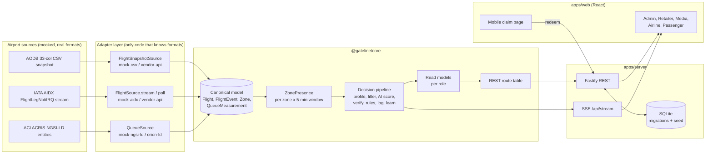

# Architecture


The same system as a Mermaid diagram (renders on GitHub):



## Runtime model

- **One clock.** The engine keeps a simulation clock (1x / 10x / 60x). Every 250 ms of real time it advances, polls the feed adapters, and runs one decision slot per 15 simulated seconds for all 182 screens. At 60x that is one slot per tick, about 20 ms of CPU.
- **Feeds drive state.** The AODB snapshot gives the schedule. Every later change (delay, gate change, boarding, departure) arrives as an AIDX message. Injected events are built as AIDX XML and travel the same parser, so the demo exercises the real ingestion path.
- **Immediate re-planning.** When an AIDX event changes a flight, the screens whose catchment includes that gate are re-planned in the same tick rather than at the next slot. The SSE stream pushes a fresh snapshot within ~300 ms, which meets the 2-second cause-and-effect requirement.
- **Jumps.** Jumping in time rebuilds the day: the schedule is reset, the feed messages up to the target time are replayed in order, and a back-fill of 10-minute windows estimates today's counters. This takes ~1 s for a full day.
- **Persistence (server).** Master data (including terminals), campaigns, creatives, promo codes, redemptions, incidents, settings, goodwill rules and Impression records are written to SQLite. Live counters are recomputed from the simulation; real redemptions are replayed from the database.

## Passenger presence (`presence.js`)

For each departing flight:

- **Airside fraction.** Passengers clear security uniformly between STD−160 and STD−100 minutes, and drain the gate between ETD−30 (boarding) and ETD−10. A delay moves the drain but not the arrival, so delayed passengers stay longer — the extra duty-free dwell the brief describes.
- **Location.** With more than 30 minutes to boarding, 40% of a flight's passengers are in the plaza and 60% near the gate. With 30 minutes or less, everyone is at the gate.
- **Landside and security.** Landside presence ramps up before security. The security zone uses ACRIS `QueueMeasurement` occupancy.
- **Arrivals.** Arrivals occupy the arrivals hall and belt screens from on-blocks +3 to +40 minutes.

A screen's crowd is the weighted sum of these contributions over its catchment (`nearestGates`, plaza, landside or arrivals weights). Flight profiles are rolled up into shares. Zone forecasts for the next 2 hours, inventory pricing and the 7-day forecast all reuse the same model.

## Decision record (logged for every slot)

```json
{ "id": "D-…-T2-G42-01", "t": 1791987000000, "screenId": "T2-G42-01",
  "profile": { "n": 442, "shares": { "holiday": 0.58, "family": 0.31, "business": 0.222, "intl": 0.57 }, "medianDwell": 52, "flights": [ … ] },
  "candidates": [ { "campaignId": "CMP-PERF15", "match": 0.7103, "boost": 1.5, "perf": 0.44, "pacing": 1, "final": 0.86, "result": "Plays", "triggers": ["XY501 delayed 45 min"] } ],
  "rule": "Highest score with trigger boost x1.5 (XY501 delayed 45 min)",
  "ai": { "provider": "mock-agent", "verified": true, "checks": [ { "name": "evidence-exists", "ok": true } ], "cites": ["AIDX:msg:MQI-AODB-000184533", …] },
  "evidence": [ { "id": "AIDX:msg:…", "source": "AIDX", "value": "XY501 → ZHQ, 144 pax in catchment, ETD 15:20 (+45)", "ageSec": 900 } ] }
```

## Data model

The **canonical entities** are documented in `packages/core/src/model.js`. The platform-owned tables are in `apps/server/migrations/` (`001_init.sql`, `002_terminals_impressions.sql`):

- **`aodb_flights`** keeps all 33 source columns, exactly as the AODB sends them.
- **Platform entities** keep indexed key columns plus a JSON document, so the model can evolve without a migration per field.
- **`impressions`** stores the Impression entity aggregated per campaign × screen × hour (plays, impressions, scans, redemptions, live redemptions, spend). The server flushes changed rows every 5 seconds.
- **GateAssignment** and **AircraftType** are derived from the AODB snapshot and AIDX updates and the aircraft reference list; they are served by the API rather than stored separately.

## Privacy

Targeting is aggregated by flight, zone and time window only. There is no boarding-pass scanning, identity matching or device tracking. Promo codes are bound to a screen, a campaign and a flight, never to a person.
